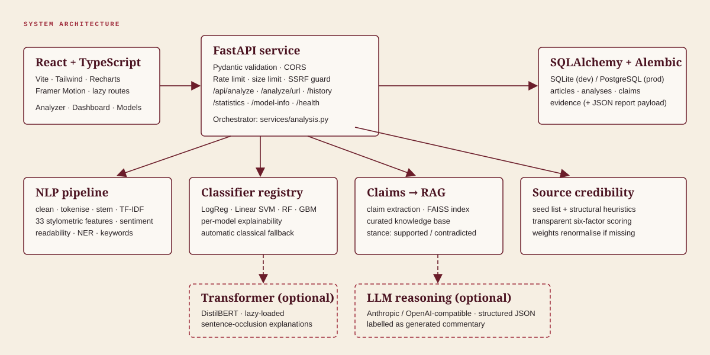
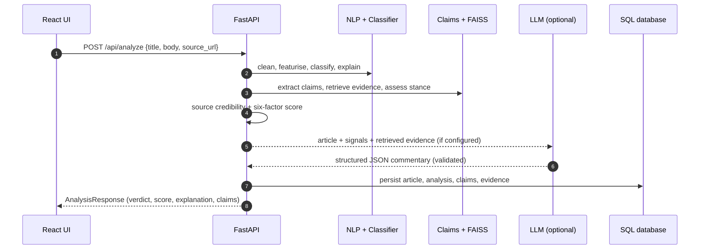
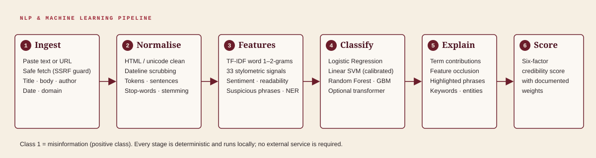
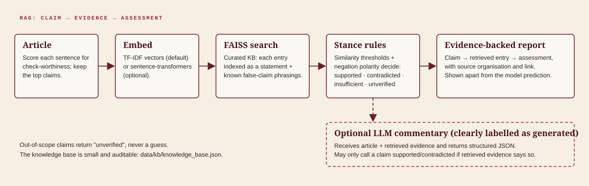
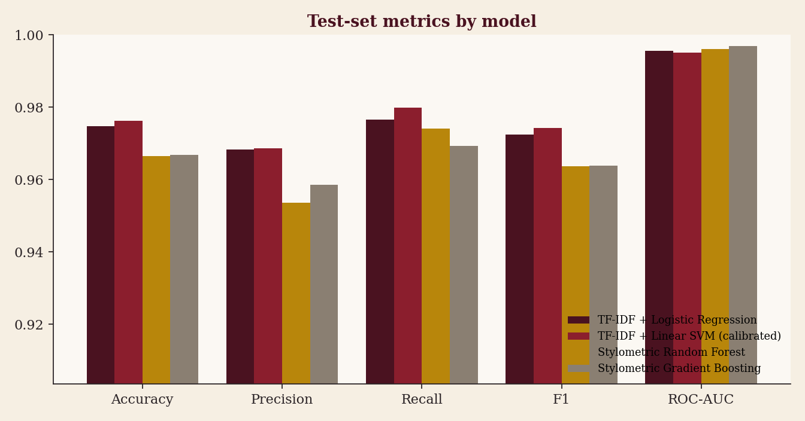
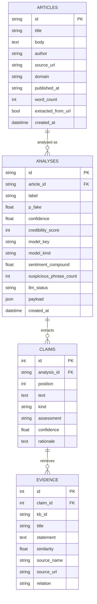
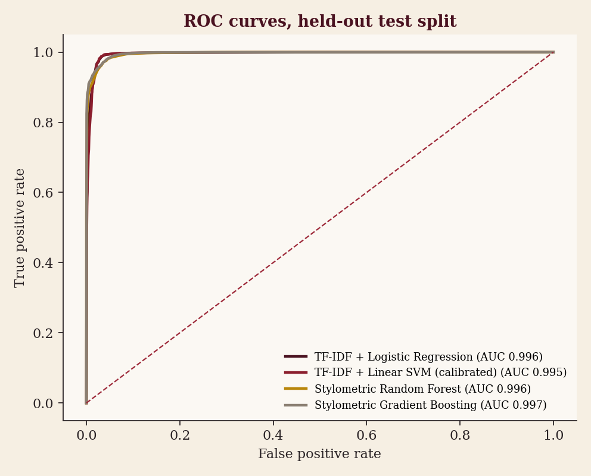
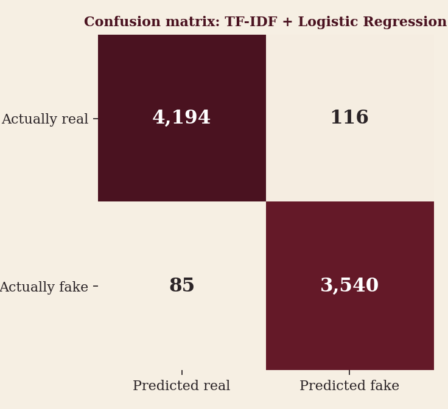

<div align="center">


<br/>


# Veritrace

**Explainable misinformation analysis that shows its work: NLP, machine learning, source credibility, vector retrieval and optional LLM reasoning in one transparent report.**

<br/>


-4A1220?style=flat-square&logo=postgresql&logoColor=F6EFE3)


[Overview](#product-overview) · [Screenshots](#screenshots) · [Architecture](#architecture) · [Models & metrics](#evaluation-metrics) · [Quick start](#installation-and-running-locally) · [API](#api-documentation) · [Responsible AI](#responsible-ai-and-limitations)

</div>

---

## Live demo

Veritrace runs locally in about two minutes (see [Quick start](#installation-and-running-locally)) and ships with six sample articles, so the full report can be demonstrated immediately without any API key. Deployment recipes for Render / Railway / Fly.io and Vercel / Netlify are in [`docs/DEPLOYMENT.md`](docs/DEPLOYMENT.md); a hosted instance is not bundled with this repository.

## Screenshots

<table>
<tr>
<td width="50%"><br/><sub><b>Landing page.</b> The gauge card is explicitly labelled illustrative; the statistics strip is live from the database.</sub></td>
<td width="50%"><br/><sub><b>Analyzer.</b> Paste text, fetch a URL, or run a built-in sample. Choose a model; LLM reasoning is optional.</sub></td>
</tr>
<tr>
<td width="50%"><br/><sub><b>Report: a clickbait health-misinformation sample.</b> Signals, credibility factors, per-term explanation, highlighted phrases.</sub></td>
<td width="50%"><br/><sub><b>Report: careful science reporting.</b> The classifier is only "uncertain"; the composite score still rewards sourcing and evidence.</sub></td>
</tr>
<tr>
<td width="50%"><br/><sub><b>Dashboard.</b> Aggregates over stored analyses, plus held-out model performance (confusion matrix, ROC).</sub></td>
<td width="50%"><br/><sub><b>Models.</b> Metrics, explainability method per model, dataset provenance and the retrieval knowledge base.</sub></td>
</tr>
</table>

<p align="center"><br/><sub>Walkthrough of a real analysis report, scrolled from verdict to claims.</sub></p>

---

## Product overview

Veritrace takes a news article (pasted text or a URL) and returns an **explainable credibility report**: a verdict from a trained classifier, a transparent six-factor credibility score, the exact phrases and features behind the decision, a source assessment, and every checkable claim matched against a curated knowledge base with retrieved evidence. An optional LLM layer adds structured, clearly-labelled commentary.

> **What it is not:** an oracle. Veritrace is decision support. It keeps *model prediction*, *retrieved evidence* and *generated commentary* visibly separate, and it says "unverified" when it does not know.

## Problem statement

Misinformation is cheap to produce and expensive to check. Single-number "fake news scores" are opaque: readers cannot tell whether a score reflects sensational wording, a dubious publisher, an unsupported claim, or simply the topic. Opaque scores are easy to over-trust and hard to challenge.

## Solution

Veritrace decomposes the question into independently inspectable signals and recombines them with documented weights:

| Question | Component | Output |
|---|---|---|
| Does it read like reliable reporting? | NLP features + stylometric model | Style signals, sensationalism index |
| What does a text classifier think? | TF-IDF + linear models (optional transformer) | `P(misinformation)`, term contributions |
| Who published it? | Source module | Seed-list tier or structural heuristics |
| Are its claims checkable and consistent with known facts? | Claim extraction → FAISS retrieval → stance rules | Claim → evidence → assessment |
| Why should I believe this explanation? | Method-appropriate XAI | Coefficients, occlusion, highlighted phrases |
| Can someone narrate the evidence? | Optional LLM, structured JSON | Labelled generated commentary |

## Key features

- **Three input modes:** paste an article, analyse a URL (SSRF-protected fetch and extraction), or run built-in samples.
- **Four trained classifiers** compared side by side, with the model that produced the verdict always shown. Optional DistilBERT with automatic classical fallback.
- **Transparent credibility score (0-100)** from six weighted factors; unavailable factors are excluded and the weights renormalised, never silently defaulted.
- **Explainability per model family:** exact coefficient × TF-IDF decomposition, feature occlusion for tree ensembles, sentence occlusion for transformers.
- **RAG fact-check layer** over a small, auditable knowledge base with negation-aware stance assessment.
- **Persistent history and analytics:** SQLAlchemy models, Alembic migration, SQLite for dev and PostgreSQL for production.
- **Production hygiene:** rate limiting, request-size limits, SSRF guard, CORS allow-list, no stack-trace leakage, health checks, Docker, 69 automated tests.

## Architecture

<p align="center"></p>



## AI / NLP pipeline

<p align="center"></p>

| Stage | Implementation |
|---|---|
| Cleaning and normalisation | HTML/URL stripping, Unicode NFKC, quote normalisation, whitespace collapse ([`preprocessing.py`](backend/app/nlp/preprocessing.py)) |
| Artefact scrubbing | Agency datelines such as `(Reuters)` are removed in training and inference, because they are publisher fingerprints rather than language |
| Tokenisation, sentences, stop-words, stemming | Regex tokeniser, abbreviation-aware sentence splitter, curated stop-list, Porter stemmer |
| TF-IDF | Word 1-2-grams, 60,000 features, sublinear TF, `min_df=3` |
| Stylometric features | 33 signals: length, lexical diversity, ALL-CAPS and exclamation rates, punctuation, quotations, Flesch reading ease and FK grade, lexicon sentiment with negation, subjectivity, emotive and absolutist wording, attribution cues, headline traits and headline-body overlap |
| Suspicious phrases | 63 categorised patterns (clickbait, urgency, conspiratorial framing, weak sourcing, overclaiming) located in the text for inline highlighting |
| Entities and keywords | Rule-based NER (people/organisations, places, dates, money, percentages) and TF-IDF keyword scoring using the trained vectoriser's IDF |

## RAG pipeline

<p align="center"></p>

1. **Claim extraction:** sentences are ranked for check-worthiness (numbers, assertion verbs, entities, causal and absolute wording). Sentences that merely *report* a claim in order to question it ("the idea that…", "debunked") are down-weighted so a rebuttal is not scored as an assertion.
2. **Embedding and index:** each knowledge-base entry contributes its established *statement* and each *known false-claim phrasing* as separate vectors in a FAISS `IndexFlatIP`. The default embedder is TF-IDF (no downloads); `EMBEDDING_BACKEND=sentence-transformers` switches to semantic embeddings.
3. **Stance assessment:** similarity thresholds plus negation polarity decide `supported`, `contradicted`, `insufficient` (related but not decisive) or `unverified` (nothing relevant). "Vaccines do **not** cause autism" is correctly *supported*, not flagged as the false claim.
4. **Presentation:** *Claim → retrieved entry → assessment*, with the source organisation, shown apart from the model prediction.

The knowledge base ([`data/kb/knowledge_base.json`](data/kb/knowledge_base.json)) holds 34 paraphrased, attributable summaries on frequently circulated health, science, history and civic claims. It is deliberately small and auditable; anything outside it is reported as `unverified`. **Evidence is retrieved, never generated.**

## ML models

<p align="center"></p>

| Key | Model | Features | Explainability |
|---|---|---|---|
| `tfidf_lr` (default) | Logistic Regression (L2, `C=8`) | TF-IDF 1-2-grams | Exact per-term contributions |
| `tfidf_svm` | Linear SVM + sigmoid calibration | TF-IDF 1-2-grams | Averaged calibrated linear weights |
| `stylometric_rf` | Random Forest (300 trees) | 33 style features, no vocabulary | Local feature occlusion |
| `stylometric_hgb` | Histogram Gradient Boosting | 33 style features, no vocabulary | Local feature occlusion |
| `transformer` (optional) | DistilBERT fine-tune | Raw text | Sentence occlusion |

The default is chosen by validation ROC-AUC among the TF-IDF models. The stylometric model also feeds the *linguistic reliability* factor of the credibility score, because it cannot rely on topic words.

## LLM integration

Optional and off by default. Set `LLM_PROVIDER=anthropic` (or `openai` for any OpenAI-compatible endpoint) and the matching key in the environment. The prompt contains the article (treated as untrusted data), the classifier output, linguistic signals and the retrieved evidence, and demands a single JSON object with: summary, red flags (suspicious claims, emotional manipulation, sensational wording, unsupported claims, contradictions, source problems), missing context, per-claim review, evidence quality and uncertainty. The reply is **validated and clamped** by Pydantic before it reaches the UI, which renders it under an "AI-generated narrative" label.

- The LLM never sets the verdict or the credibility score.
- It may call a claim *supported* or *contradicted* only if the retrieved evidence says so.
- Any failure (no key, timeout, malformed output) degrades to the local pipeline with an explanatory message.
- The provider call is exercised in the test suite against a mocked transport; no live-provider run is included in this repository.

## Explainable AI

| Question | Where it is answered |
|---|---|
| How confident is the model? | Verdict header: `P(fake)` and confidence |
| Which words or features drove it? | Diverging bar chart of contributions toward FAKE vs REAL |
| Which phrases look manipulative? | Article text with inline highlights and reasons |
| How was the score computed? | Per-factor bars with weight and effective weight, plus the formula |
| What does the source look like? | Pass/fail/unknown checks with explanations |
| Do the models agree? | "Models compared" panel |

> Generated LLM reasoning is labelled as such and is not presented as a faithful trace of the classifier's internals. For linear models the term decomposition is exact; for tree ensembles and transformers it is a perturbation analysis and is labelled accordingly.

### Credibility score

```
credibility = Σ(weight × factor) / Σ(weights of available factors)
```

| Factor | Weight | Derived from |
|---|---:|---|
| Linguistic reliability | 20% | P(real) from the stylometric model (no topic words) |
| Source credibility | 20% | Seed-list tier, or structural heuristics for unlisted domains (capped at 75) |
| Evidence strength | 20% | Share of *decisively checked* claims that were supported |
| Restraint (low sensationalism) | 15% | 100 − sensationalism index |
| Headline-body consistency | 10% | Headline vocabulary actually developed in the body |
| Classifier assessment | 15% | P(real) from the selected model |

The weights are a documented design choice, not learned parameters. Missing inputs (no source URL, no checkable claims) are excluded and the rest renormalised.

## Observed behaviour on the bundled samples

These are live outputs of the shipped models on the six illustrative articles in [`data/samples/samples.json`](data/samples/samples.json) (written for this project; not real news). They are included because the failure modes are as instructive as the successes.

| Sample | Classifier verdict (`tfidf_lr`) | `P(fake)` | Credibility | Notes |
|---|---|---:|---:|---|
| Council approves library budget | Likely reliable | 0.03 | 89 | Attributed quotes, figures, no warning signals |
| "SHOCKING: Government hid the cure for cancer…" | Likely misinformation | 1.00 | 26 | 22 flagged phrases; miracle-cure claim contradicted by the KB; low-scoring source |
| 5G towers spreading the virus | Likely misinformation | 0.82 | 48 | Three claims contradicted by the KB; anonymous sourcing |
| Sea-level study reporting | **Uncertain** | 0.58 | 83 | Good sourcing and supported claims; the text classifier is unsure about science vocabulary |
| Vaccines-and-autism explainer | **Likely misinformation** | 0.88 | 78 | **A false positive from the text classifier.** The article rebuts the myth, but TF-IDF models read health vocabulary as a risk cue. The stylometric models score it as reliable (≈0.01) and the composite score stays high |
| Emotive budget opinion piece | Likely misinformation | 0.93 | 38 | Opinion with no verifiable claims; sensational style is what the models detect, which is not the same as false |

The second-to-last row is the main reason for the multi-factor design and the model-comparison panel: no single signal is trusted on its own.

## Tech stack

| Layer | Technologies |
|---|---|
| Frontend | React 18, TypeScript, Vite, Tailwind CSS, Framer Motion, Recharts, React Router |
| Backend | Python, FastAPI, Pydantic v2, SQLAlchemy 2, Alembic |
| ML / NLP | scikit-learn, NumPy, pandas, NLTK (Porter stemmer only), custom lexicons |
| Retrieval | FAISS, TF-IDF embeddings (optional sentence-transformers) |
| Optional | Hugging Face Transformers / PyTorch, Anthropic or OpenAI-compatible LLM |
| Data | SQLite (dev), PostgreSQL (prod) |
| Ops | Docker, Docker Compose, nginx, pytest |

Every technology above has a function in the running system; optional ones are marked optional and degrade gracefully.

## Project structure

```
veritrace/
├── backend/
│   ├── app/
│   │   ├── api/routes.py            # HTTP endpoints
│   │   ├── nlp/                     # preprocessing, features, lexicons, entities/keywords
│   │   ├── ml/                      # classical models, optional transformer wrapper
│   │   ├── services/                # analysis orchestrator, rag, claims, source, scoring, llm, extractor, registry
│   │   ├── scripts/seed.py          # populate dashboard with real pipeline runs
│   │   ├── models.py  schemas.py    # ORM tables and the API contract
│   │   └── main.py  config.py  database.py
│   ├── alembic/                     # migrations
│   ├── tests/                       # 69 tests
│   └── Dockerfile  requirements.txt
├── frontend/                        # React + TypeScript app
├── ml/
│   ├── download_dataset.py          # fetch the training corpus
│   ├── train.py                     # train + evaluate 4 classical models
│   ├── train_transformer.py         # optional DistilBERT fine-tune
│   ├── make_figures.py              # README evaluation figures
│   └── artifacts/                   # trained models + metrics.json
├── data/
│   ├── kb/                          # knowledge base + source ratings (editable)
│   └── samples/                     # sample articles
├── assets/                          # logo, banners, screenshots, diagrams, gifs
├── docs/                            # API, deployment, models, screenshot script
├── docker-compose.yml  .env.example  LICENSE  CONTRIBUTING.md
```

## Installation and running locally

**Requirements:** Python 3.11+ (3.12 recommended), Node 20+.

```bash
git clone <your-repo-url> veritrace && cd veritrace

# 1. Backend
python -m venv .venv
source .venv/bin/activate              # Windows: .venv\Scripts\activate
pip install -r backend/requirements.txt
cd backend
uvicorn app.main:app --reload --port 8000     # API + docs at http://localhost:8000/docs

# 2. Frontend (new terminal)
cd frontend
npm install
npm run dev                                    # http://localhost:5173
```

The repository includes trained model artifacts, so no training is needed to run it. On first start SQLite is created at `data/veritrace.db`. Optionally populate the dashboard with real analyses (no fabricated rows):

```bash
cd backend
python -m app.scripts.seed --samples           # the six sample articles
python -m app.scripts.seed --from-test 60      # 60 held-out test articles (needs the dataset)
```

**Database options.** SQLite is the zero-config default. For PostgreSQL set `DATABASE_URL` and run `alembic upgrade head` (the Docker image does this automatically):

```bash
docker compose up --build        # PostgreSQL + API + UI -> http://localhost:8080
```

**Tests**

```bash
cd backend && python -m pytest        # 69 tests: NLP, models, RAG, scoring, API, DB, error handling, security
```

## Environment variables

Copy [`.env.example`](.env.example) to `.env`. Every variable is optional for local use.

| Variable | Default | Purpose |
|---|---|---|
| `DATABASE_URL` | SQLite in `data/` | SQLite or PostgreSQL connection string |
| `CORS_ORIGINS` | localhost:5173 | Allowed browser origins |
| `RATE_LIMIT_PER_MINUTE` | `40` | Per-IP limit on analysis endpoints |
| `DEFAULT_MODEL` | `auto` | `auto`, `tfidf_lr`, `tfidf_svm`, `stylometric_rf`, `stylometric_hgb`, `transformer` |
| `TRANSFORMER_MODEL`, `TRANSFORMER_FAKE_LABEL` | unset | Optional transformer (hub id or local path) |
| `EMBEDDING_BACKEND` | `tfidf` | `tfidf` or `sentence-transformers` |
| `LLM_PROVIDER` | `none` | `none`, `anthropic`, `openai` |
| `LLM_MODEL`, `ANTHROPIC_API_KEY`, `OPENAI_API_KEY`, `OPENAI_BASE_URL` | unset | LLM configuration; keys are read from the environment only |
| `VITE_API_BASE_URL` | empty (frontend build) | Backend URL for deployed frontends |

## API documentation

Interactive docs at `/docs` (Swagger) and `/redoc`. Full reference in [`docs/API.md`](docs/API.md).

| Method | Path | Purpose |
|---|---|---|
| `POST` | `/api/analyze` | Analyse pasted text |
| `POST` | `/api/analyze/url` | Fetch, extract and analyse a URL |
| `GET` | `/api/analysis/{id}` | Stored analysis |
| `DELETE` | `/api/analysis/{id}` | Delete an analysis |
| `GET` | `/api/history` | Paginated, filterable history |
| `GET` | `/api/statistics` | Dashboard aggregates |
| `GET` | `/api/model-info` | Model cards, measured metrics, dataset provenance |
| `GET` | `/api/samples` · `/api/kb` | Sample articles · knowledge-base entries |
| `GET` | `/api/health` | Database, models, RAG, LLM and transformer status |

```bash
curl -s localhost:8000/api/analyze -H 'content-type: application/json' \
  -d '{"title":"Council approves library budget","body":"The city council voted 5-2 on Tuesday to approve a $4.2 million budget for the public library system, according to council documents. A spokesperson said the new schedule would be announced by the end of the month.","use_llm":false}'
```

## Database architecture



Migrations live in [`backend/alembic/versions`](backend/alembic/versions). The full report JSON is stored alongside the normalised claim and evidence rows so history can be re-rendered exactly.

## Model training

```bash
pip install -r backend/requirements-dev.txt
python ml/download_dataset.py        # parallel, resumable download -> data/raw/
python ml/train.py                   # trains 4 models, writes ml/artifacts/*.joblib + metrics.json
python ml/make_figures.py            # regenerates the evaluation figures above
```

**Dataset.** [`GonzaloA/fake_news`](https://huggingface.co/datasets/GonzaloA/fake_news) on Hugging Face (a news corpus of reliable-agency articles and articles from flagged fake-news sites; 24,353 / 8,117 / 8,117 train / validation / test rows before cleaning). Its dataset card lists the licence as *unknown*, so **the data is not bundled**; the download script fetches it on demand and `data/raw/` is git-ignored. After cleaning, minimum-length filtering and removing cross-split duplicates the experiments use 23,792 / 7,930 / 7,935 articles. Training details: seed 42, class 1 = fake, no test-set tuning.

**Optional transformer.** `python ml/train_transformer.py --epochs 1 --max-train 6000` fine-tunes DistilBERT on the same splits and writes `ml/artifacts/transformer/` with its own metrics; then set `TRANSFORMER_MODEL=ml/artifacts/transformer`. It is not trained or shipped by default, and the application never claims to use it unless it is loaded.

## Evaluation metrics

All numbers are measured by `ml/train.py` on the held-out test split (n = 7,935; fake is the positive class) and stored in [`ml/artifacts/metrics.json`](ml/artifacts/metrics.json).

| Model | Accuracy | Precision | Recall | F1 | ROC-AUC |
|---|---:|---:|---:|---:|---:|
| TF-IDF + Logistic Regression *(default)* | 0.9747 | 0.9683 | 0.9766 | 0.9724 | 0.9956 |
| TF-IDF + Linear SVM (calibrated) | 0.9763 | 0.9686 | 0.9799 | 0.9742 | 0.9951 |
| Stylometric Random Forest | 0.9665 | 0.9536 | 0.9741 | 0.9637 | 0.9961 |
| Stylometric Gradient Boosting | 0.9669 | 0.9585 | 0.9694 | 0.9639 | 0.9969 |

<table><tr>
<td></td>
<td></td>
</tr></table>

> **Read these numbers with care.** The corpus separates by *publisher* (wire-agency reporting versus a handful of flagged sites), so high scores partly reflect publisher style. The top learned terms confirm it: `said`, `on Tuesday`, `Washington` push toward real; `via`, `video`, `breaking`, `just` push toward fake. Datelines are scrubbed, but the benchmark remains easier than real-world misinformation, and the sample table above shows false positives on out-of-domain text. Expect lower performance on topics, formats and outlets unlike the training data.

## Future improvements

- A topically diverse, multi-publisher training corpus and cross-dataset evaluation (the largest known gap).
- Fine-tuned transformer evaluated on the same splits, with calibration analysis.
- Semantic embeddings and a larger, versioned knowledge base ingested from fact-check feeds, with NLI-based stance classification in place of rules.
- Reverse-image and image-text consistency checks; multilingual support.
- Authentication and per-user history; background job queue for slow URL fetches and LLM calls.

## Responsible AI and limitations

- **Predictions are probabilistic.** A score is an estimate with error bars you cannot see, not a ruling.
- **False positives and false negatives are real,** as the bundled-sample table shows. Satire, opinion, health explainers and unfamiliar topics are all at risk of misclassification.
- **Style is not truth.** Sensational writing can be accurate and calm writing can be false. Veritrace reports both views separately for that reason.
- **Retrieved evidence must be verified independently.** It comes from a small curated, paraphrased knowledge base; absence of a match means *unverified*, never *true* or *false*.
- **LLM output can hallucinate.** It is optional, labelled as generated, constrained to the retrieved evidence, validated structurally, and never decides the verdict.
- **Political and sensitive content needs particular care.** Source ratings are an editable seed list and heuristics, not authoritative judgements about any publisher.
- **Dataset bias.** Models inherit publisher, era and topic biases of their training data (see above).
- **Intended use:** decision support for readers, students and fact-checkers, and a demonstration of explainable-AI engineering. It is not suitable for automated moderation or any decision with consequences for individuals without human review.

## Disclaimer

Veritrace is provided as-is for research and education, without warranty. It does not determine the truth of any statement. Publisher names in the seed list are used only to illustrate source scoring and do not constitute endorsements or accusations. The training dataset is not distributed and remains subject to its own terms.

## Contributing

Contributions are welcome. Please read [`CONTRIBUTING.md`](CONTRIBUTING.md): in short, keep results honest, label generated content, add a test with every behavioural change, and run `pytest` and the frontend typecheck before opening a pull request.

## License

Source code is released under the [MIT License](LICENSE). The training dataset is not included and has its own terms.

## Creator

**Divyanshi**: designed and built Veritrace end to end (NLP and ML pipeline, retrieval layer, API, database, interface and documentation).

<br/>

<div align="center">

━━━━━━━━━━━━━━━━━━━━━━━━━━━━━━━━━━━━━━


### Veritrace

<sub>**AI &nbsp;•&nbsp; NLP &nbsp;•&nbsp; MISINFORMATION INTELLIGENCE**</sub>

<sub>Built with AI • NLP • Machine Learning</sub>

**Created by Divyanshi**

━━━━━━━━━━━━━━━━━━━━━━━━━━━━━━━━━━━━━━

</div>
